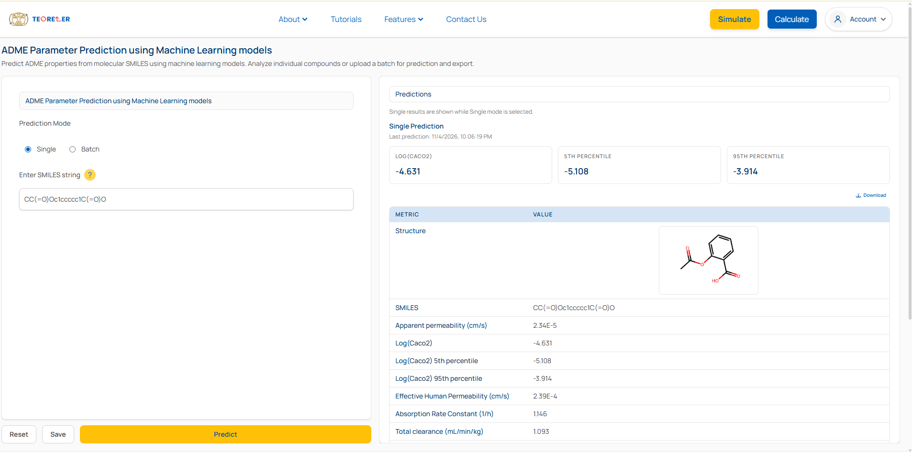

# CG-GML: A Data-Driven Constrained Guided Graph-based Multitask Learning Framework for Fraction Unbound Prediction

## :bookmark_tabs: Table of Content
1. [Introduction](#introduction)
1. [Data Collection](#data-collection)
1. [Requirements](#requirements)
1. [Repository Outline](#repository-outline)
1. [Usages](#usages)
1. [Web-based Platform](#web-based-platform)
1. [References](#references)

## :book: Introduction
The CG-GML (Constraint-Guided Graph Multitask Learning) framework is a molecular property prediction model developed to predict the plasma protein unbound fraction $(f_u)$ from molecular structures. Within this framework, the graph-based molecular representations is integrated with molecular descriptors to capture complementary structural and physicochemical information. Unlike conventional approaches, CG-GML incorporates descriptor-guided regularization term in the model loss function to capture relevant physicochemical relationships. These descriptor-guided constraints were formulated through data-driven approaches using the molecular descriptors exhibiting strongest statistical dependencies with $(f_u)$. During training, the model was allowed to adaptively optimize the contributions of different learning objectives. By combining multiple information related to $(f_u)$, CG-GML aims to improve the accuracy while maintaining the consistency between $(f_u)$ and other molecular properties.


## :dna: Data Collection

Eight publicly available datasets were merged, and systematically filtered following the methods described in the `Dataset preparation and Graph construction` section in the main manuscript to construct the final dataset of 8121 chemical compounds. The data sources are summarised as follows:

| Dataset | # Collected Datapoints |  |
|---|---|---|
| e-Drug3D (2012)| 1290 | [link](https://chemoinfo.ipmc.cnrs.fr/DOWNLOAD/MOLDB/e-Drug3D_2197_PK.txt) |
| Ingle et al. (2016)| 1651 | [link](https://pubs.acs.org/jcisd8/article-supplement/848984/xlsx/ci6b00291_si_001/) |
| Lombardo et al. (2018) | 1352 | [link](https://dmd.aspetjournals.org/cms/10.1124/dmd.118.082966/attachment/23162f03-5ccc-413e-acc2-453e45d435ae/mmc2-supplemental_82966_rev.xls) |
| Mulpuru et al. (2021) | 5471 | [link](https://pubs.acs.org/acsodf/article-supplement/421433/xlsx/ao0c05846_si_002/) |
| Iwata et al. (2022)| 741 | [link](https://ndownloader.figstatic.com/files/36746369) |
| Pore and Roy (2024)| 1812 | [link](https://pubs.rsc.org/dd/article-supplement/846060/xlsx/d4dd00082j6_suppl/) |
| Krumpholz  et al. (2024)| 1327 | [link](https://oup.silverchair-cdn.com/oup/backfile/Content_public/Journal/database/2024/10.1093_database_baae063/2/baae063_supp.zip?Expires=1796504454&Signature=p4JyF7Z5-fSL9~w2nDpqYBcdDoHTQQ7Zh2O1OIYbBisNtAPuWVuogx1z-qiiG9Sow~lD8AiIqWLsYCKyQ5W0TBhqIo0gZRH2W9s1DtLM7oXH9V5u4AmPqaCMyN3XMa2Rsc53hTZMJy~bs9DZS4GXyiQbWBY2CMKU6V5dU7WEAYnLcu5M8DUr9AZE7CZJJ6eEr87XNCTTWEYUz11IybVE7QuYNOUISgfi9Te49v2uv5~lertpADs5RtCsRf7KQDh3Jxnfk60HlmVAz6JxtRYrUG91zyyHwfAjUnVzz7p5d9BmYX7r6uiphZvebZ5XBFg8WyTe4P67-lnj63L02aObAA__&Key-Pair-Id=APKAIE5G5CRDK6RD3PGA) |
| Jia et al. (2025)| 5620 | [link](https://pubs.acs.org/jmcmar/article-supplement/3669730/xlsx/jm5c00340_si_001/) |

## 	:gear: Requirements

The following packages are required for the reproduciblity of the published code.

| Package | Version | Package | Version |
|---|---|---|---|
| Python | 3.12 | CUDA | 12.8 |
| Pytorch | 2.7.1 | RdKit | 2025.9.2 |
| Pip | 24.2 | Conda | 24.5.0 |
| Numpy | 1.26.4 | Pandas | 2.2.2 |
| Matplotlib | 3.9.2 | Shap | 0.48.0 |
| Gensim | 4.3.3 | Scikit-learn | 1.5.2 |
| Mordred | 1.2.0 | Mol2Vec | 0.2.2 |
| Transformers | 4.57.1 | Xgboost | 3.0.2 |


## :open_file_folder: Repository Outline

The repository is outlined as follows:

| Folder/File | Details |
|---|---|
| inference_utils_fu | Folder for all the utility files used in model prediction |
| metadata | Folder for auxiliary information, including, node features in molecular graph, atomic descriptors collected from Webelements, etc.  |
| inference_fu.py | Main inference file, including, the model loading, data preparation, and model inferences |
| prediction.ipynb | Example uses |


## :rocket: Usages

Please follow the steps one by one to predict the **Fraction Unbound** values of any chemical compound.

1. Download [`best_models_fu.zip`](https://www.teoreler.com/) file containing the pretrained models from [Teoreler](https://www.teoreler.com/).

1. Place the downloaded ZIP file in this and extract its contents there.

1. Run the following commands:

    -  **For both single or multiple SMILES:**

    ```python
        from inference_fu import Predict_FU

        # Single SMILES
        smiles = 'CCO'
        y_pred = Predict_FU(smiles=smiles)

        # Multiple SMILES
        smiles_list = ['CCO', 'CCN', 'CC(=O)O']
        y_pred = Predict_FU(smiles_list)
    ```

## :globe_with_meridians: Web-based Platform

An web-based platform, [Teoreler](https://www.teoreler.com/mlpred/), has been developed and made freely available for molecular property prediction.




### :computer: **How to Use?**

- For single SMILES:

    - Under the `Prediction Mode`, select  __Single__.
    - Enter the SMILES in the designated input field.
    - Click the Predict button to obtain the prediction.

- For multiple SMILES:

    - Under the `Prediction Mode`, select  __Batch__.
    - Prepare the input file using either of the following methods:
    - **Process - 1: Prepare Your Own File**
    
        - Create a $.csv$ or $.xlsx$ file containing the SMILES notations.
        - Ensure that the column containing the SMILES notations is named as **SMILES**.

    - **Process - 2: Use the Provided Template**
    
        - Download the SMILES batch input [template](https://www.teoreler.com/templates/SMILES_batch_file.xlsx).
        - Enter the SMILES in the corresponding column.

    - Upload the prepared file using file upload option.
    - Click the Predict button to initiate batch prediction.

## :scroll: Citation

Use the following format to cite this work.

```bibtex

@article{mondal2026cggml,
  title={CG-GML: A Data-Driven Constrained Guided Graph-based Multitask Learning Framework for Fraction Unbound Prediction},
  author={Rajdeep Mondal, Rajith Rajoli, Andrew Owen, and Soumitra Samanta},
  year={2026},
  url={https://www.teoreler.com/mlpred/}
}
```